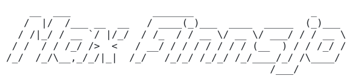

**Developer in Stockholm. I build complete solutions, from the first idea to the server they run on.**

Twenty years in IT: dotcom-era web design, support and ITIL at SEB and Karolinska, nine years of freelance web and e-commerce, full-stack since. Web apps, WordPress plugins, automations and AI tools, built end to end and kept running on my own Linux servers.

**Portfolio:** [max.contigomedia.se/portfolio](https://max.contigomedia.se/portfolio/)

### 🛠️ What I build

- **[ISAKKE](https://github.com/maxfinnsjo/isakke)** · [live demo](https://max.contigomedia.se/isakke): ask about your rights at work in Sweden and an AI answers from the actual labour law, citing the exact paragraph (RAG). Runs fully local or on free-tier models.
- **[Steps & Stops Tours](https://www.stepsandstopstours.se/)**: a Stockholm walking-tour company built end to end. Brand, website, the **TBS Booking System** WordPress plugin ([calendar](https://www.stepsandstopstours.se/tbs-calendar/)) and the **[Guided Tour](https://maxfinnsjo.github.io/guided-tour/)** app the guide carries on the day.
- **SkandiNavet**: a Nordic news channel in Text-TV style, written and read by AI anchors. [Watch it live](https://max.contigomedia.se/skandinavet).
- **Jobhunt**: a Flask app on the Swedish Public Employment Service API. Search, apply by email, Gmail sync, ~940 tests.
- **Boring Trotter**: tests betting strategies for Swedish trotting against two years of real race data, with leakage checks and practice bets. No real money, ever. Streamlit dashboard.
- **Alien Angler** and **Space Surfer**: 3D roguelites in Godot 4. Surreal fishing, and surfing the currents of open space.
- **Station**: a KDE Plasma theme generated from your wallpaper: colours, icons, cursors, terminals.
- **The home lab**: a phone app for habits and money with open banking and step data, and local LLMs on an RTX 3060.

Several of these keep their source private. The [portfolio](https://max.contigomedia.se/portfolio/) shows most of them with screenshots.

### 🕹️ Other things you can open

<table>
  <tr>
    <td width="50%" valign="top">
       
      <b><a href="https://github.com/maxfinnsjo/programmingCardgame">Programming Card Game</a></b> · <a href="https://programming-card-game.onrender.com">live demo</a> 
      Two-player card game where the cards are code. Java, Spring Boot.
    </td>
    <td width="50%" valign="top">
       
      <b><a href="https://github.com/maxfinnsjo/droplet">Droplet</a></b> · <a href="https://maxfinnsjo.github.io/droplet/droplet.html">live demo</a> 
      A water drop that shimmers and pops. One HTML file: SVG, CSS, a little JS.
    </td>
  </tr>
  <tr>
    <td width="50%" valign="top">
       
      <b><a href="https://github.com/maxfinnsjo/port-of-call">Port of Call</a></b> · <a href="https://maxfinnsjo.github.io/port-of-call/">live demo</a> 
      A personal portal with an icon rail. One HTML file, one stylesheet, no JavaScript.
    </td>
    <td width="50%" valign="top">
       
      <b><a href="https://github.com/maxfinnsjo/global-template">Global Template</a></b> · <a href="https://maxfinnsjo.github.io/global-template/">live demo</a> 
      My minimal starter for small sites: native CSS layers, a popover menu, no build step.
    </td>
  </tr>
  <tr>
    <td width="50%" valign="top">
       
      <b><a href="https://github.com/maxfinnsjo/local-library">Local Library</a></b> 
      My first Django project: catalogue, loans, staff roles. Refreshed for Django 5.2, 37 tests.
    </td>
    <td width="50%" valign="top">
       
      <b><a href="https://github.com/maxfinnsjo/simple-todos">Simple Todos</a></b> 
      Real-time todos with accounts and private tasks. Meteor, Svelte, MongoDB.
    </td>
  </tr>
</table>

More: [Early projects](https://github.com/maxfinnsjo/early-projects) (tutorials and experiments, 2020–2025)

### 🧰 Tools

                  

### 📫 Say hi

max.finnsjo@gmail.com · Stockholm, Sweden

Off the keyboard: qigong every morning, top 100 in The Finals (Quick Cash), science fiction on the nightstand.
